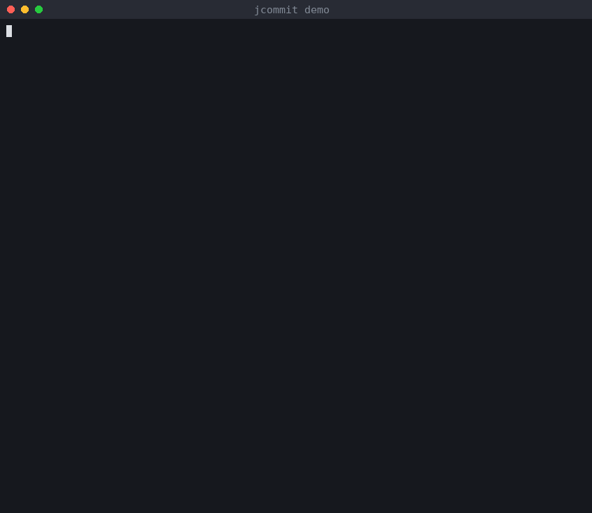

# jcommit

**What annoyed me.** Our Jenkins pipeline fails the build on any commit that isn't exactly
`<Type>: <JIRA-ID>` / `Title: <exact JIRA summary>` / `Description: <≥200 chars>`.
I only learned I'd broken a rule (199 characters, `Fix:` instead of `Bug:`, a paraphrased title) after
pushing and waiting for CI, then amending and pushing again. Every commit, across several repos.
Counting to 200 by hand and re-copying the ticket title each time was the worst part.

**What I built.** A single-file, stdlib-only Python CLI (no dependencies, no network).

- `jcommit install` adds a `commit-msg` hook, so a bad message is rejected locally with the exact reason
  ("Description is 150 chars, needs >= 200 (50 more)").
- `jcommit new` builds a valid message: JIRA ID comes from the branch name (`SC-663-foo` → `SC-663`),
  the exact title is remembered per ticket after the first time, and it refuses to commit until the
  description is long enough.
- Merge/revert commits are let through; extra trailer lines only warn.

```
python3 jcommit.py install
python3 jcommit.py new -t Bug -d "what I changed and why, in my own words ... (200+ chars)"
python3 -m unittest discover tests
```

**Left out on purpose.** Checking that the ticket exists, is assigned to me, and that the title truly
matches JIRA needs credentials and an API call, so Jenkins stays the authority there (the cache just
stops me retyping titles). I picked the rules from the team email; I couldn't see Jenkins' exact regex,
so the hook follows the documented rules, and trailers/merges are an assumption.

**Next.** Optional JIRA lookup (token from env) to verify and auto-fill the title; a `--amend`
mode that repairs the last commit; a `prepare-commit-msg` template pre-filled in the editor.


